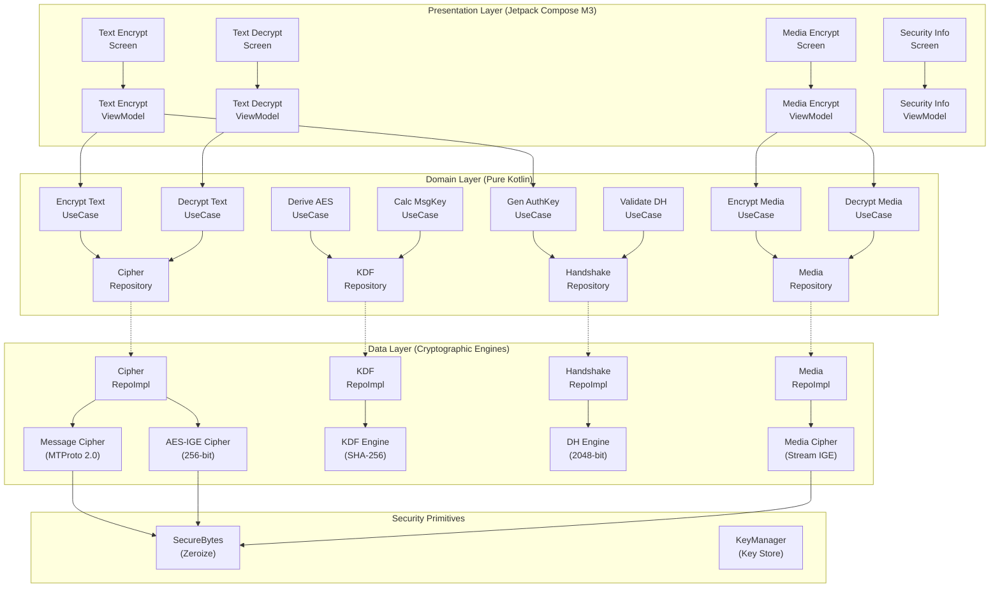

# MTProtoCrypto: Telegram MTProto 2.0 Cryptographic SDK for Android

[](https://jitpack.io/#gargpadmakar/MTProtoCrypto)
[](LICENSE)
[](https://developer.android.com)
[](https://android-arsenal.com/api?level=26)
[](https://kotlinlang.org)
[](https://github.com/gargpadmakar/MTProtoCrypto)

**MTProtoCrypto** is a production-grade, high-performance, and thread-safe Android Kotlin cryptographic library implementing **Telegram MTProto 2.0 cryptographic primitives**, message encryption and decryption, 2048-bit Diffie-Hellman (DH) key exchange, and **Telegram Secret Chat media streaming encryption**.

Engineered with **Clean Architecture**, **MVVM**, the **UseCase Pattern**, **Repository Pattern**, **Koin Dependency Injection**, and **Kotlin Coroutines**.

---

## Table of Contents

- [Overview & Cryptographic Capabilities](#overview--cryptographic-capabilities)
- [Why MTProtoCrypto: Overcoming Android JCE Limitations](#why-mtprotocrypto-overcoming-android-jce-limitations)
- [Architecture Diagram](#architecture-diagram)
- [Target Applications & Real-World Use Cases](#target-applications--real-world-use-cases)
- [JitPack Installation](#jitpack-installation)
- [Sample Application User Guide](#sample-application-user-guide)
- [SDK API Examples](#sdk-api-examples)
  - [1. Koin Dependency Injection Setup](#1-koin-dependency-injection-setup)
  - [2. MTProto 2.0 Text Message Encryption](#2-mtproto-20-text-message-encryption)
  - [3. MTProto 2.0 Text Message Decryption & Verification](#3-mtproto-20-text-message-decryption--integrity-verification)
  - [4. Secret Chat Media Streaming](#4-secret-chat-media-streaming-images-video-audio-docs)
  - [5. Diffie-Hellman 2048-bit Handshake](#5-diffie-hellman-handshake-2048-bit-modp-safe-prime)
- [Cryptographic Specifications & Protocol Separation](#cryptographic-specifications--protocol-separation)
- [Security & Memory Safety](#security--memory-safety)
- [Frequently Asked Questions (FAQ)](#frequently-asked-questions-faq)
- [Build & Testing Instructions](#build--testing)
- [JitPack Release Checklist](#jitpack-release-checklist)
- [License](#license)

---

## Overview & Cryptographic Capabilities

Telegram's MTProto 2.0 mobile security protocol provides state-of-the-art symmetric encryption, key derivation, and authenticated communication designed specifically for mobile networks with high latency and weak connections.

MTProtoCrypto brings full MTProto 2.0 cryptographic compatibility to modern Android applications without depending on native C/C++ NDK binaries:

- **AES-256-IGE Symmetric Cipher:** Full implementation of Infinite Garble Extension dual-block feedback chaining ($c_i = E_K(m_i \oplus y_{i-1}) \oplus x_{i-1}$) using Bouncy Castle core primitives.
- **MTProto 2.0 Key Derivation Function (KDF):** Directional SHA-256 derivation supporting Client-to-Server ($x=0$) and Server-to-Client ($x=8$) offsets.
- **Message Integrity & Authentication:** Computes middle 128 bits of SHA-256 message keys (`msg_key`) with strict **constant-time verification** before releasing decrypted plaintext.
- **Anti-Traffic Analysis Padding:** Conforms to MTProto 2.0 random padding specifications ($12 \le \text{padding} \le 1024$ bytes, 16-byte aligned) preventing eavesdroppers from deducing packet contents via payload length inspection.
- **Diffie-Hellman Key Exchange:** 2048-bit MODP safe-prime authorization key agreement (RFC 3526 Group 14) with full subgroup and generator validation.
- **Telegram Secret Chat Media Encryption:** Ephemeral 256-bit media key and IV generation with 64-bit key fingerprints.
- **Large File Streaming:** Constant 64 KB memory chunk streaming supporting arbitrarily large files (photos, videos, audio, documents) without heap allocations or `OutOfMemoryError`.

---

## Why MTProtoCrypto: Overcoming Android JCE Limitations

| Feature / Capability | Standard Android JCE (`javax.crypto`) | MTProtoCrypto SDK |
| :--- | :--- | :--- |
| **AES-IGE Mode Support** | Throws `NoSuchAlgorithmException` | Fully Supported via pure Bouncy Castle block engine |
| **MTProto 2.0 Directional KDF** | Not Available (requires custom manual math) | Built-in conforming to official Telegram specs |
| **Constant-Time MsgKey Check** | Requires manual implementation | Built-in using `MessageDigest.isEqual` |
| **Secret Chat Media Streaming** | Not Available | Built-in constant 64 KB chunk streaming |
| **Diffie-Hellman Safe Prime Check** | Manual `BigInteger` validation needed | Built-in RFC 3526 Group 14 validator |
| **Architecture** | Raw cryptographic APIs | Clean Architecture + MVVM + Koin + UseCases |
| **Memory Zeroization** | Manual byte array wiping | Lifecycle-scoped `SecureBytes` with auto-wipe |

---

## Architecture Diagram



---

## Target Applications & Real-World Use Cases

The **MTProtoCrypto SDK** is suitable for any Android application requiring Telegram-grade security, high-throughput symmetric encryption, traffic-analysis obfuscation, and zero-overhead large file streaming:

### 1. End-to-End Encrypted (E2EE) Messaging Apps
- **Private 1-on-1 & Secret Chats:** Implement Telegram Secret Chat-grade encryption for text, ephemeral media, and attachments.
- **Voice & Video Notes:** Stream-encrypt multimedia audio and video notes with per-file ephemeral 256-bit media keys.
- **Custom Telegram Clients:** Build third-party Telegram clients, forks, or Telegram bot companions that communicate via official MTProto 2.0 transport encryption and DH authorization key exchange.

### 2. Secure File Vaults, Hidden Galleries & Media Lockers
- **Private Photo & Video Vaults:** Encrypt private photo albums and high-resolution videos on-device using hardware-accelerated AES-256-IGE.
- **Secret Document Safes:** Lock confidential PDFs, financial records, contracts, and identity scans.
- **Constant-Memory Large File Support:** Stream-processes arbitrarily large files (from megabytes to multiple gigabytes) in 64 KB chunks without memory spikes or `OutOfMemoryError`.

### 3. Zero-Knowledge Cloud Storage & Secure Backups
- **Client-Side Pre-Upload Encryption:** Encrypt files and database backups on Android *before* uploading to Google Drive, AWS S3, Firebase, or custom servers.
- **True Zero-Knowledge:** Even if remote servers or transmission networks are breached, the stored ciphertext cannot be decrypted without the client's local key.

### 4. FinTech, Healthcare & Enterprise Confidential Apps
- **FinTech & Banking Apps:** Protect payment receipts, bank statements, transaction logs, and customer credentials against network interception or rooted-device extraction.
- **Telemedicine & Health Records:** Secure medical history, prescriptions, and biometric data in compliance with strict privacy standards (e.g. HIPAA, GDPR).
- **Traffic Analysis Resistance:** MTProto 2.0 random padding (12 to 1024 bytes) obfuscates exact payload sizes, preventing adversaries from identifying message content or action types via packet size inspection.

### 5. Custom Client-Server & P2P Protocols
- **P2P & Local Mesh Channels:** Establish authenticated, encrypted channels over Wi-Fi Direct, Bluetooth, or raw WebSockets using 2048-bit Diffie-Hellman key agreement without relying on external Certificate Authorities (CAs).

---

## Sample Application User Guide

The project includes a production-grade Jetpack Compose Material 3 sample application (`:app`) demonstrating the MTProtoCrypto SDK capabilities in real-time.

The application has four primary screens accessible via the bottom navigation bar:

### 1. Encrypt Tab (Text Message Encryption)
- **Active Session Key:** Displays the active 2048-bit Diffie-Hellman authorization key (`auth_key`) and its calculated 64-bit ID (`auth_key_id`).
- **New DH Session:** Tap "New DH" to generate a fresh 2048-bit session keypair on demand.
- **Direction Selector:** Select either "Client -> Server" (KDF offset $x=0$) or "Server -> Client" (KDF offset $x=8$).
- **Plaintext Input:** Type or paste your message.
- **Encrypt Message:** Tap the button to encrypt. The SDK automatically:
  1. Packs the payload with a 4-byte length prefix.
  2. Appends between 12 and 1024 bytes of cryptographically secure random padding (16-byte alignment).
  3. Derives the 128-bit `msg_key` from SHA-256.
  4. Derives the 256-bit AES key and 256-bit IGE IV using MTProto 2.0 KDF.
  5. Performs AES-256-IGE encryption.
- **Output:** Displays the 128-bit `msg_key` and the full wire-format Base64 ciphertext with one-tap clipboard copy buttons.

### 2. Decrypt Tab (Text Decryption & Verification)
- **Automatic Synchronization:** The active authorization key is automatically synchronized from the Encrypt screen.
- **Auto-Populate:** If you encrypted a message on the Encrypt screen, switching to the Decrypt tab automatically pre-fills the Base64 ciphertext.
- **Direction Selector:** Match the transmission direction used during encryption.
- **Verify & Decrypt:** Tap the button to process. The SDK:
  1. Validates that `auth_key_id` in the message header matches the active session key.
  2. Derives directional AES-IGE keys.
  3. Decrypts the ciphertext block-by-block.
  4. Validates `msg_key` in **constant-time** (`MessageDigest.isEqual`).
  5. Releases plaintext **only if** verification succeeds.
- **Integrity Badge:** A verified confirmation displays when authentication succeeds, showing the exact number of stripped random padding bytes. If the ciphertext was tampered with by even one bit, a safe error is shown without exposing secret keys.

### 3. Media Tab (Secret Chat Streaming Encryption)
- **Select Media File:** Tap "Select Media File (SAF)" to open the Android Storage Access Framework system document picker. Select any photo, video, audio track, or document of any size (from kilobytes to gigabytes).
- **File Metadata:** Displays original file name, formatted file size (Bytes, KB, MB, or GB), and MIME type.
- **Encrypt Stream:** Tap "Encrypt Stream" to start streaming encryption:
  - Generates an ephemeral random 256-bit media key and 256-bit media IV via `SecureRandom`.
  - Streams the file in constant 64 KB memory chunks using AES-256-IGE without `OutOfMemoryError` risks.
  - A real-time progress bar shows percentage and processed byte counts.
  - Displays the generated Media Key, Media IV, and 64-bit key fingerprint.
- **Cancel Operation:** Tap "Cancel Streaming Operation" at any time to abort the streaming job gracefully.
- **Decrypt Stream:** Tap "Decrypt Stream" to decrypt the stored ciphertext stream back to its original unpadded format.
- **Verification:** An integrity verification banner confirms that the decrypted file byte size and binary content match the original file 100%.

### 4. Security Tab (Specifications & Architecture)
- Displays reference cryptographic parameters:
  - Symmetric Cipher: AES-256-IGE (Infinite Garble Extension)
  - Key & IV Lengths: 256 bits each (32-byte key, 32-byte IV $y_0 \parallel x_0$)
  - KDF: MTProto 2.0 SHA-256 directional derivation
  - DH MODP Group: RFC 3526 Group 14 (2048-bit safe prime, generator 2)
  - Padding Bounds: 12..1024 bytes random padding with 16-byte alignment
  - Protocol Separation: Clear architectural distinction between MTProto transport layer encryption and Telegram Secret Chat media streaming encryption.

---

## JitPack Installation

The library is published and distributed via JitPack.

### 1. Repository Configuration

Add the JitPack maven repository to your project's `settings.gradle.kts`:

```kotlin
// settings.gradle.kts
dependencyResolutionManagement {
    repositoriesMode.set(RepositoriesMode.FAIL_ON_PROJECT_REPOS)
    repositories {
        google()
        mavenCentral()
        maven { url = uri("https://jitpack.io") }
    }
}
```

### 2. Dependency Coordinate

Add the dependency to your application module's `build.gradle.kts`:

```kotlin
dependencies {
    // Verified JitPack release coordinate
    implementation("com.github.gargpadmakar:MTProtoCrypto:v1.0.0")
}
```

> **Artifact ID:** `MTProtoCrypto`  
> **Package:** `com.gargpadmakar.mtproto.crypto`  
> **AAR Name:** `mtproto-crypto-android.aar`

---

## SDK API Examples

### 1. Koin Dependency Injection Setup

Initialize the SDK modules in your `Application` class:

```kotlin
import android.app.Application
import com.gargpadmakar.mtproto.crypto.di.mtProtoSdkModules
import org.koin.android.ext.koin.androidContext
import org.koin.core.context.startKoin

class MyApp : Application() {
    override fun onCreate() {
        super.onCreate()
        startKoin {
            androidContext(this@MyApp)
            modules(mtProtoSdkModules)
        }
    }
}
```

### 2. MTProto 2.0 Text Message Encryption

```kotlin
import com.gargpadmakar.mtproto.crypto.domain.model.EncryptionDirection
import com.gargpadmakar.mtproto.crypto.domain.usecase.EncryptTextUseCase
import org.koin.core.component.KoinComponent
import org.koin.core.component.inject

class MessageSender : KoinComponent {
    private val encryptTextUseCase: EncryptTextUseCase by inject()

    suspend fun sendMessage(plainText: String, authKey: ByteArray) {
        val result = encryptTextUseCase(
            text = plainText,
            authKey = authKey,
            direction = EncryptionDirection.CLIENT_TO_SERVER
        )

        result.fold(
            onSuccess = { encryptedMessage ->
                // Wire format: authKeyId (8 bytes) + msgKey (16 bytes) + encryptedData (N bytes)
                val wireBytes: ByteArray = encryptedMessage.toWireBytes()
                val base64: String = encryptedMessage.toBase64()
                println("Encrypted wire payload size: ${wireBytes.size} bytes")
            },
            onFailure = { error ->
                System.err.println("Encryption failed: ${error.message}")
            }
        )
    }
}
```

### 3. MTProto 2.0 Text Message Decryption & Integrity Verification

```kotlin
import com.gargpadmakar.mtproto.crypto.domain.model.EncryptionDirection
import com.gargpadmakar.mtproto.crypto.domain.usecase.DecryptTextUseCase
import org.koin.core.component.KoinComponent
import org.koin.core.component.inject

class MessageReceiver : KoinComponent {
    private val decryptTextUseCase: DecryptTextUseCase by inject()

    suspend fun receiveMessage(base64Ciphertext: String, authKey: ByteArray) {
        val result = decryptTextUseCase(
            base64Wire = base64Ciphertext,
            authKey = authKey,
            direction = EncryptionDirection.CLIENT_TO_SERVER
        )

        result.fold(
            onSuccess = { decryptedMessage ->
                // Plaintext is released ONLY after constant-time msg_key verification
                println("Decrypted plaintext: ${decryptedMessage.text()}")
                println("Padding stripped: ${decryptedMessage.paddingLength} bytes")
                
                // Zeroize sensitive buffer when finished
                decryptedMessage.wipe()
            },
            onFailure = { error ->
                // InvalidMessageKeyException thrown if message was tampered with or key is wrong
                System.err.println("Integrity verification failed: ${error.message}")
            }
        )
    }
}
```

### 4. Secret Chat Media Streaming (Images, Video, Audio, Docs)

Streaming architecture encrypts and decrypts files of arbitrary size with a constant 64 KB memory footprint:

```kotlin
import com.gargpadmakar.mtproto.crypto.domain.usecase.EncryptMediaUseCase
import com.gargpadmakar.mtproto.crypto.domain.usecase.DecryptMediaUseCase
import java.io.InputStream
import java.io.OutputStream
import org.koin.core.component.KoinComponent
import org.koin.core.component.inject

class MediaManager : KoinComponent {
    private val encryptMediaUseCase: EncryptMediaUseCase by inject()
    private val decryptMediaUseCase: DecryptMediaUseCase by inject()

    suspend fun encryptFile(sourceStream: InputStream, targetStream: OutputStream, fileSize: Long) {
        // Generates random 256-bit media key and 256-bit media IV
        val metadata = encryptMediaUseCase.generateMetadata(
            fileSize = fileSize,
            mimeType = "image/jpeg",
            fileName = "photo.jpg"
        )

        encryptMediaUseCase(
            input = sourceStream,
            output = targetStream,
            metadata = metadata,
            onProgress = { progress ->
                println("Encryption progress: ${(progress.fraction * 100).toInt()}%")
            },
            isCancelled = { false }
        ).getOrThrow()
    }
}
```

### 5. Diffie-Hellman Handshake (2048-bit MODP Safe Prime)

```kotlin
import com.gargpadmakar.mtproto.crypto.domain.usecase.GenerateAuthorizationKeyUseCase
import org.koin.core.component.KoinComponent
import org.koin.core.component.inject

class HandshakeService : KoinComponent {
    private val generateAuthKeyUseCase: GenerateAuthorizationKeyUseCase by inject()

    fun performKeyAgreement() {
        val params = generateAuthKeyUseCase.getDefaultParameters()
        
        // Client generates keypair: g^a mod p
        val clientKeyPair = generateAuthKeyUseCase.generateKeyPair(params)
        
        // Compute shared auth_key from server public value: K = (g_b)^a mod p
        val authResult = generateAuthKeyUseCase(
            peerPublicValue = serverPublicBigInt,
            privateExponent = clientKeyPair.privateExponent,
            params = params
        ).getOrThrow()

        println("Auth Key Size: ${authResult.authKey.size} bytes (2048 bits)")
        println("auth_key_id: ${authResult.authKeyId.size} bytes (64 bits)")
    }
}
```

---

## Cryptographic Specifications & Protocol Separation

| Capability | Algorithm / Standard | Specification Details |
| :--- | :--- | :--- |
| **Symmetric Mode** | AES-256-IGE | Dual-block feedback chaining: $c_i = E_K(m_i \oplus y_{i-1}) \oplus x_{i-1}$ |
| **IV Structure** | 32 Bytes (256-bit) | Split into two 16-byte initial vectors: $y_0 = IV[0..15]$, $x_0 = IV[16..31]$ |
| **KDF** | MTProto 2.0 SHA-256 | Directional offsets: $x=0$ (Client $\to$ Server), $x=8$ (Server $\to$ Client) |
| **Message Key** | 16 Bytes (128-bit) | Middle 128 bits of SHA-256($\text{auth\_key\_part} + \text{payload} + \text{padding}$) |
| **Message Padding** | MTProto 2.0 Random | $12 \le \text{padding} \le 1024$ bytes, total message length divisible by 16 |
| **DH Handshake** | RFC 3526 Group 14 | Standardized 2048-bit safe prime $p$, generator $g \in \{2..7\}$ |
| **Secret Chat Media** | AES-256-IGE | Ephemeral 256-bit random key + 256-bit IV per file with 64-bit fingerprint |

> [!IMPORTANT]
> **Protocol Distinction:**  
> - **MTProto 2.0 Transport Encryption:** Uses a long-lived 2048-bit Authorization Key (`auth_key`), derived `aes_key` and `aes_iv` via directional KDF, and 12..1024 bytes of random padding with constant-time message key verification.
> - **Telegram Secret Chat Media Encryption:** Uses ephemeral random 256-bit media keys and 256-bit media IVs per file transmitted over the secret channel.
> - This SDK implements both modes with explicit separation. It does **not** claim Telegram Cloud API storage/upload RPC compatibility.

---

## Security & Memory Safety

1. **Constant-Time Verification:**  
   Message key validation uses `MessageDigest.isEqual` to eliminate timing side channels. Plaintext is **never** decrypted or made available before cryptographic verification succeeds.
2. **Best-Effort Zeroization:**  
   `SecureBytes` wraps sensitive byte arrays and implements `wipe()` (`Arrays.fill(bytes, 0.toByte())`) within `try/finally` blocks.
3. **Thread Safety:**  
   Cryptographic engines instantiate per-operation cipher states with immutable parameters. Zero shared mutable buffers. Verified via multi-threaded stress tests.
4. **Lifecycle & Coroutine Management:**  
   CPU operations run on `Dispatchers.Default`, file streaming runs on `Dispatchers.IO`, and ViewModels leverage `viewModelScope` with cancellation propagation to prevent resource leaks.

---

## Frequently Asked Questions (FAQ)

### What is MTProto 2.0 and how does it improve over MTProto 1.0?
MTProto 2.0 replaces SHA-1 with SHA-256 across all key derivation steps and incorporates larger random padding (between 12 and 1024 bytes). This ensures that ciphertext length leaks zero information regarding plaintext message length and provides provable security against known theoretical chosen-ciphertext attacks on older MTProto 1.0 specifications.

### How does AES-IGE (Infinite Garble Extension) mode work in MTProto?
AES-IGE is an error-propagating cipher mode that chains both plaintext and ciphertext across adjacent blocks. It uses a 32-byte initialization vector split into $y_0$ (bytes 0..15) and $x_0$ (bytes 16..31). Encryption of block $i$ is calculated as $c_i = E_K(m_i \oplus y_{i-1}) \oplus x_{i-1}$ with state updates $x_i = c_i$ and $y_i = m_i$. Any corruption in transmission affects all subsequent blocks, providing fast integrity detection.

### Why does standard Android JCE throw NoSuchAlgorithmException for AES/IGE/NoPadding?
The standard Android Java Cryptography Extension (JCE) provider does not include an implementation for IGE mode. Attempting to call `Cipher.getInstance("AES/IGE/NoPadding")` on Android results in a `NoSuchAlgorithmException`. MTProtoCrypto solves this by implementing AES-IGE chaining directly on top of Bouncy Castle's hardware-optimized `AESEngine`.

### How does streaming media encryption prevent OutOfMemoryError on Android?
Instead of reading an entire file into memory before encryption, `MediaCipher` processes the input stream in fixed 64 KB buffers. Whether encrypting a 5 MB image or a 2 GB 4K video, heap consumption remains constant at under 128 KB, completely eliminating `OutOfMemoryError` on low-RAM Android devices.

### Is Java BigInteger modular exponentiation constant-time?
No. Standard Java `BigInteger.modPow()` uses sliding-window or Karatsuba/Montgomery modular exponentiation and is not constant-time. MTProtoCrypto documents this transparently and enforces high-entropy 2048-bit exponents and safe-subgroup bounds ($2^{1984} \le g_a \le p - 2^{1984}$) to guard against small-subgroup confinement attacks.

---

## Build & Testing

### Assemble Debug Application
```bash
./gradlew assembleDebug
```

### Build Release Library AAR
```bash
./gradlew :mtproto-crypto:assembleRelease
```
The output AAR is located at:
`mtproto-crypto/build/outputs/aar/mtproto-crypto-release.aar`

### Run All Unit & Concurrency Tests
```bash
./gradlew test
```

---

## JitPack Release Checklist

To publish a release on JitPack:

1. Ensure all tests and release builds pass:
   ```bash
   ./gradlew test :mtproto-crypto:assembleRelease
   ```
2. Commit working tree changes.
3. Create and push a semantic version tag (e.g. `v1.0.0`):
   ```bash
   git tag -a v1.0.0 -m "Release v1.0.0"
   git push origin main --tags
   ```
4. Verify the build on JitPack: `https://jitpack.io/#gargpadmakar/MTProtoCrypto`

---

## Author & Support

- **Author:** Padmakar Garg
- **Email:** techboostpg@gmail.com
- **Repository:** [https://github.com/gargpadmakar/MTProtoCrypto](https://github.com/gargpadmakar/MTProtoCrypto)
- **Issues & Contributions:** Pull requests and issues are welcome on GitHub.

---

## License

```text
Copyright 2026 Padmakar Garg

Licensed under the Apache License, Version 2.0 (the "License");
you may not use this file except in compliance with the License.
You may obtain a copy of the License at

    http://www.apache.org/licenses/LICENSE-2.0

Unless required by applicable law or agreed to in writing, software
distributed under the License is distributed on an "AS IS" BASIS,
WITHOUT WARRANTIES OR CONDITIONS OF ANY KIND, either express or implied.
See the License for the specific language governing permissions and
limitations under the License.
```
