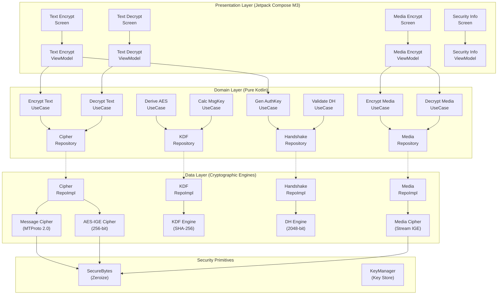

# MTProtoCrypto Android SDK

[](LICENSE)
[](https://developer.android.com)
[](https://developer.android.com)
[](https://kotlinlang.org)

**MTProtoCrypto** is a high-performance, modular, and thread-safe Android Kotlin cryptographic library implementing **Telegram MTProto 2.0 cryptographic primitives**, message encryption/decryption, 2048-bit Diffie-Hellman handshake, and **Telegram Secret Chat media streaming encryption**.

Designed with **Clean Architecture**, **MVVM**, the **UseCase Pattern**, **Repository Pattern**, **Koin Dependency Injection**, and **Kotlin Coroutines**.

---

## Architecture Diagram



---

## 🎯 Target Applications & Real-World Use Cases

The **MTProtoCrypto SDK** is suitable for any Android application requiring Telegram-grade security, high-throughput symmetric encryption, traffic-analysis obfuscation, and zero-overhead large file streaming:

### 1. 💬 End-to-End Encrypted (E2EE) Messaging Apps
- **Private 1-on-1 & Secret Chats:** Implement Telegram Secret Chat-grade encryption for text, ephemeral media, and attachments.
- **Voice & Video Notes:** Stream-encrypt multimedia audio and video notes with per-file ephemeral 256-bit media keys.
- **Custom Telegram Clients:** Build third-party Telegram clients, forks, or Telegram bot companions that communicate via official MTProto 2.0 transport encryption and DH authorization key exchange.

### 2. 🔒 Secure File Vaults, Hidden Galleries & Media Lockers
- **Private Photo & Video Vaults:** Encrypt private photo albums and high-resolution videos on-device using hardware-accelerated AES-256-IGE.
- **Secret Document Safes:** Lock confidential PDFs, financial records, contracts, and identity scans.
- **Constant-Memory Large File Support:** Stream-processes arbitrarily large files (from megabytes to multiple gigabytes) in 64 KB chunks without memory spikes or `OutOfMemoryError`.

### 3. ☁️ Zero-Knowledge Cloud Storage & Secure Backups
- **Client-Side Pre-Upload Encryption:** Encrypt files and database backups on Android *before* uploading to Google Drive, AWS S3, Firebase, or custom servers.
- **True Zero-Knowledge:** Even if remote servers or transmission networks are breached, the stored ciphertext cannot be decrypted without the client's local key.

### 4. 🏥 FinTech, Healthcare & Enterprise Confidential Apps
- **FinTech & Banking Apps:** Protect payment receipts, bank statements, transaction logs, and customer credentials against network interception or rooted-device extraction.
- **Telemedicine & Health Records:** Secure medical history, prescriptions, and biometric data in compliance with strict privacy standards (e.g. HIPAA, GDPR).
- **Traffic Analysis Resistance:** MTProto 2.0 random padding (12 to 1024 bytes) obfuscates exact payload sizes, preventing adversaries from identifying message content or action types via packet size inspection.

### 5. 🌐 Custom Client-Server & P2P Protocols
- **P2P & Local Mesh Channels:** Establish authenticated, encrypted channels over Wi-Fi Direct, Bluetooth, or raw WebSockets using 2048-bit Diffie-Hellman key agreement without relying on external Certificate Authorities (CAs).

---

## JitPack Installation

The library is designed for distribution through JitPack as a multi-module Android Library (`mtproto-crypto`).

### 1. Repository Configuration

Add JitPack to your `settings.gradle.kts` (or root `build.gradle.kts`):

```kotlin
// settings.gradle.kts
dependencyResolutionManagement {
    repositoriesMode.set(RepositoriesMode.FAIL_ON_PROJECT_REPOS)
    repositories {
        google()
        mavenCentral()
        maven { url = uri("https://jitpack.io") }
    }
}
```

### 2. Dependency Coordinate

Add the dependency to your application module's `build.gradle.kts`:

```kotlin
dependencies {
    // Standard multi-module JitPack coordinate
    implementation("com.github.gargpadmakar.MTProtoCrypto:mtproto-crypto:1.0.0")
}
```

> **Artifact ID:** `mtproto-crypto-android.aar`  
> **Package:** `com.gargpadmakar.mtproto.crypto`

---

## SDK API Examples

### 1. Koin Dependency Injection Setup

Initialize the SDK modules in your `Application` class:

```kotlin
import android.app.Application
import com.gargpadmakar.mtproto.crypto.di.mtProtoSdkModules
import org.koin.android.ext.koin.androidContext
import org.koin.core.context.startKoin

class MyApp : Application() {
    override fun onCreate() {
        super.onCreate()
        startKoin {
            androidContext(this@MyApp)
            modules(mtProtoSdkModules)
        }
    }
}
```

### 2. MTProto 2.0 Text Message Encryption

```kotlin
import com.gargpadmakar.mtproto.crypto.domain.model.EncryptionDirection
import com.gargpadmakar.mtproto.crypto.domain.usecase.EncryptTextUseCase
import org.koin.core.component.KoinComponent
import org.koin.core.component.inject

class MessageSender : KoinComponent {
    private val encryptTextUseCase: EncryptTextUseCase by inject()

    suspend fun sendMessage(plainText: String, authKey: ByteArray) {
        val result = encryptTextUseCase(
            text = plainText,
            authKey = authKey,
            direction = EncryptionDirection.CLIENT_TO_SERVER
        )

        result.fold(
            onSuccess = { encryptedMessage ->
                // Official MTProto wire format: authKeyId (8) + msgKey (16) + encryptedData (N)
                val wireBytes: ByteArray = encryptedMessage.toWireBytes()
                val base64: String = encryptedMessage.toBase64()
                println("Encrypted wire payload size: ${wireBytes.size} bytes")
            },
            onFailure = { error ->
                System.err.println("Encryption failed: ${error.message}")
            }
        )
    }
}
```

### 3. MTProto 2.0 Text Message Decryption & Integrity Verification

```kotlin
import com.gargpadmakar.mtproto.crypto.domain.model.EncryptionDirection
import com.gargpadmakar.mtproto.crypto.domain.usecase.DecryptTextUseCase
import org.koin.core.component.KoinComponent
import org.koin.core.component.inject

class MessageReceiver : KoinComponent {
    private val decryptTextUseCase: DecryptTextUseCase by inject()

    suspend fun receiveMessage(base64Ciphertext: String, authKey: ByteArray) {
        val result = decryptTextUseCase(
            base64Wire = base64Ciphertext,
            authKey = authKey,
            direction = EncryptionDirection.CLIENT_TO_SERVER
        )

        result.fold(
            onSuccess = { decryptedMessage ->
                // Plaintext is released ONLY after constant-time msg_key verification
                println("Decrypted plaintext: ${decryptedMessage.text()}")
                println("Padding stripped: ${decryptedMessage.paddingLength} bytes")
                
                // Zeroize sensitive buffer when finished
                decryptedMessage.wipe()
            },
            onFailure = { error ->
                // InvalidMessageKeyException thrown if message was tampered or key is wrong
                System.err.println("Integrity verification failed: ${error.message}")
            }
        )
    }
}
```

### 4. Secret Chat Media Streaming (Images, Video, Audio, Docs)

Streaming architecture encrypts/decrypts arbitrary size files in constant 64KB memory:

```kotlin
import com.gargpadmakar.mtproto.crypto.domain.usecase.EncryptMediaUseCase
import com.gargpadmakar.mtproto.crypto.domain.usecase.DecryptMediaUseCase
import java.io.InputStream
import java.io.OutputStream
import org.koin.core.component.KoinComponent
import org.koin.core.component.inject

class MediaManager : KoinComponent {
    private val encryptMediaUseCase: EncryptMediaUseCase by inject()
    private val decryptMediaUseCase: DecryptMediaUseCase by inject()

    suspend fun encryptFile(sourceStream: InputStream, targetStream: OutputStream, fileSize: Long) {
        // Generates random 256-bit media key and 256-bit media IV
        val metadata = encryptMediaUseCase.generateMetadata(
            fileSize = fileSize,
            mimeType = "image/jpeg",
            fileName = "photo.jpg"
        )

        encryptMediaUseCase(
            input = sourceStream,
            output = targetStream,
            metadata = metadata,
            onProgress = { progress ->
                println("Encryption progress: ${(progress.fraction * 100).toInt()}%")
            },
            isCancelled = { false }
        ).getOrThrow()
    }
}
```

### 5. Diffie-Hellman Handshake (2048-bit MODP Safe Prime)

```kotlin
import com.gargpadmakar.mtproto.crypto.domain.usecase.GenerateAuthorizationKeyUseCase
import org.koin.core.component.KoinComponent
import org.koin.core.component.inject

class HandshakeService : KoinComponent {
    private val generateAuthKeyUseCase: GenerateAuthorizationKeyUseCase by inject()

    fun performKeyAgreement() {
        val params = generateAuthKeyUseCase.getDefaultParameters()
        
        // Client generates keypair: g^a mod p
        val clientKeyPair = generateAuthKeyUseCase.generateKeyPair(params)
        
        // Compute shared auth_key from server public value: K = (g_b)^a mod p
        val authResult = generateAuthKeyUseCase(
            peerPublicValue = serverPublicBigInt,
            privateExponent = clientKeyPair.privateExponent,
            params = params
        ).getOrThrow()

        println("Auth Key Size: ${authResult.authKey.size} bytes (2048 bits)")
        println("auth_key_id: ${authResult.authKeyId.size} bytes (64 bits)")
    }
}
```

---

## Cryptographic Specifications & Protocol Separation

| Capability | Algorithm / Standard | Specification Details |
| :--- | :--- | :--- |
| **Symmetric Mode** | AES-256-IGE | Dual-block feedback chaining: $c_i = E_K(m_i \oplus y_{i-1}) \oplus x_{i-1}$ |
| **IV Structure** | 32 Bytes (256-bit) | Split into two 16-byte initial vectors: $y_0 = IV[0..15]$, $x_0 = IV[16..31]$ |
| **KDF** | MTProto 2.0 SHA-256 | Directional offsets: $x=0$ (Client $\to$ Server), $x=8$ (Server $\to$ Client) |
| **Message Key** | 16 Bytes (128-bit) | Middle 128 bits of SHA-256($\text{auth\_key\_part} + \text{payload} + \text{padding}$) |
| **Message Padding** | MTProto 2.0 Random | $12 \le \text{padding} \le 1024$ bytes, total message length divisible by 16 |
| **DH Handshake** | RFC 3526 Group 14 | Standardized 2048-bit safe prime $p$, generator $g \in \{2..7\}$ |
| **Secret Chat Media** | AES-256-IGE | Ephemeral 256-bit random key + 256-bit IV per file with 64-bit fingerprint |

> [!IMPORTANT]
> **Protocol Distinction:**  
> - **MTProto 2.0 Transport Encryption:** Uses a long-lived 2048-bit Authorization Key (`auth_key`), derived `aes_key` and `aes_iv` via directional KDF, and 12..1024 bytes of random padding with constant-time message key verification.
> - **Telegram Secret Chat Media Encryption:** Uses ephemeral random 256-bit media keys and 256-bit media IVs per file transmitted over the secret channel.
> - This SDK implements both modes with explicit separation. It does **not** claim Telegram Cloud API storage/upload RPC compatibility.

---

## Security & Memory Safety

1. **Constant-Time Verification:**  
   Message key validation uses `MessageDigest.isEqual` to eliminate timing side channels. Plaintext is **never** decrypted or made available before cryptographic verification succeeds.
2. **Best-Effort Zeroization:**  
   `SecureBytes` wraps sensitive byte arrays and implements `wipe()` (`Arrays.fill(bytes, 0.toByte())`) within `try/finally` blocks.
3. **Thread Safety:**  
   Cryptographic engines instantiate per-operation cipher states with immutable parameters. Zero shared mutable buffers. Verified via multi-threaded stress tests.
4. **Lifecycle & Coroutine Management:**  
   CPU operations run on `Dispatchers.Default`, file streaming runs on `Dispatchers.IO`, and ViewModels leverage `viewModelScope` with cancellation propagation to prevent resource leaks.

---

## Build & Testing

### Assemble Debug Application
```bash
./gradlew assembleDebug
```

### Build Release Library AAR
```bash
./gradlew :mtproto-crypto:assembleRelease
```
The output AAR will be located at:
`mtproto-crypto/build/outputs/aar/mtproto-crypto-release.aar`

### Run All Unit & Concurrency Tests
```bash
./gradlew test
```

---

## JitPack Release Checklist

To publish a release on JitPack:

1. Ensure all tests and release builds pass:
   ```bash
   ./gradlew test :mtproto-crypto:assembleRelease
   ```
2. Commit working tree changes.
3. Create and push a semantic version tag (e.g. `v1.0.0`):
   ```bash
   git tag -a v1.0.0 -m "Release v1.0.0"
   git push origin main --tags
   ```
4. Verify the build on JitPack: `https://jitpack.io/#gargpadmakar/MTProtoCrypto`

---

## License

```text
Copyright 2026 Padmakar Garg

Licensed under the Apache License, Version 2.0 (the "License");
you may not use this file except in compliance with the License.
You may obtain a copy of the License at

    http://www.apache.org/licenses/LICENSE-2.0

Unless required by applicable law or agreed to in writing, software
distributed under the License is distributed on an "AS IS" BASIS,
WITHOUT WARRANTIES OR CONDITIONS OF ANY KIND, either express or implied.
See the License for the specific language governing permissions and
limitations under the License.
```

